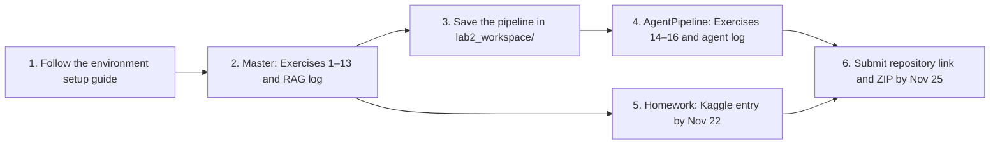

# DM2026 Lab 2

Your map of the lab: what to do, in what order, where files live, and what to submit. You will represent SemEval emotion tweets, train classifiers, compare retrieval methods, direct an agent over the saved pipeline, and build a model for the class Kaggle competition.

**Before you start:** Follow the step-by-step environment setup guide in [DM2026-Lab2-Announcement](https://github.com/william-code87/DM2026-Lab2-Announcement.git) before opening the notebooks.

## At a glance

| Item | Details |
| --- | --- |
| Environment | Python 3.11 with `uv` (`pyproject.toml` and `uv.lock`). The Master and AgentPipeline run on CPU; the competition may benefit from a GPU. |
| Release | October 26. |
| Competition closes | November 22. Submit your Kaggle prediction before the competition closes; check Kaggle for the exact closing time. |
| Lab submission deadline | November 25, 11:59 pm, as stated in the Homework notebook. |
| Exercises | 13 in the Master notebook; 3 in the AgentPipeline notebook. |
| Grading | Part 1: 40 points; Part 2: 30 points; Part 3: 30 points |
| Competition | [Data Mining Class Kaggle Competition](https://www.kaggle.com/competitions/2026-dm-lab-2-private-competition). |
| Submission route | Push your work to your repository, then submit its link and a backup ZIP on NTU COOL. See [What to submit](#what-to-submit-and-how-it-is-graded). |

## The order to work in



1. Run `DM2026-Lab2-Master.ipynb` from the top. Answer Exercises 1–13 in the notebook. Section 8 runs retrieval and RAG; Section 9 saves the fitted pipeline.
2. Open `DM2026-Lab2-AgentPipeline.ipynb` after Section 9 has created `lab2_workspace/manifest.json`. Use the agent to run controlled experiments and answer Exercises 14–16, citing its `result_id`s.
3. Complete the competition code in `DM2026-Lab2-Homework.ipynb` and submit your prediction to Kaggle by **November 22**. Capture your private-leaderboard ranking, then finish the Markdown report in the same notebook.
4. By **November 25 at 11:59 pm**, check the notebooks and both encrypted logs, push the work to your repository, and submit the repository link and backup ZIP on NTU COOL.

## The notebooks

| Notebook | What you do | Where the work goes |
| --- | --- | --- |
| `DM2026-Lab2-Master.ipynb` | Prepare four emotion classes; build BoW, TF-IDF, Word2Vec, Doc2Vec, FastText, and MiniLM features; compare KNN, SVM, Naive Bayes, and MLP classifiers; test retrieval and RAG. | Answers and visible cell outputs in the notebook; MiniLM cache in `data/embeddings/`; fitted pipeline in `lab2_workspace/`; encrypted RAG log in `session_logs/`. |
| `DM2026-Lab2-AgentPipeline.ipynb` | Direct an agent to reproduce and vary classifier results, compare retrievers, and inspect errors. | Answers to Exercises 14–16 in the notebook and an encrypted agent log in `session_logs/`. |
| `DM2026-Lab2-Homework.ipynb` | Develop the Kaggle model, document preprocessing, features, model, and AI prompts, and include a ranking screenshot. | Code and Markdown report inside this notebook. Its student-information cell links to `pics/pic_ranking.png`; add the screenshot if using that location. |

## Setup

Follow the [Lab 2 environment setup guide](https://github.com/william-code87/DM2026-Lab2-Announcement.git) before starting this repository. It covers installing Python and `uv`, installing dependencies, configuring an API key, and opening JupyterLab.

Once `uv` is installed, two commands from this repository's root are all you need:

```bash
uv sync              # creates the environment and installs the pinned dependencies
uv run jupyter lab   # starts JupyterLab using that environment
```

`uv sync` reads `pyproject.toml` and `uv.lock`, so every student ends up with identical versions. It needs Python 3.11 and about 3 GB of free disk: the environment itself is 1.7 GB, `uv` keeps the files it downloaded in a cache, and the MiniLM model in Section 5 adds 88 MB the first time it runs. That first `uv sync` takes a while; later runs are immediate. Always start the notebooks with `uv run jupyter lab` rather than activating anything by hand, and do not install packages yourself: the chat widget in the AgentPipeline notebook only works with the pinned versions.

Run the notebooks from this repository's root directory so their relative paths resolve correctly. The supplied SemEval data is already in `data/semeval/`. Run the Master through Section 9 before opening the AgentPipeline: that section creates the workspace the agent needs. The Homework notebook may be run separately for the competition.

## Where everything is

These folders and files are supplied with the repository:

| Path | What it contains | When you use it |
| --- | --- | --- |
| `data/semeval/train/` | Supplied SemEval emotion-intensity training data: 3,606 rows after seven cross-split duplicates were removed. | The Master loads it to build features and train models. |
| `data/semeval/dev/` | Supplied SemEval development data: 347 rows. | The Master uses it for evaluation and retrieval examples. |
| `lab2_tools/` | Shared workspace-loading code used by the agent tools. | The AgentPipeline imports it after the Master saves its workspace. |
| `lab2_tools/inspection/` | Tools that read saved results and inspect the pipeline without running a new experiment. | The agent may use them immediately. |
| `lab2_tools/experiments/` | Tools for classifier and retrieval experiments and tweet examples. | The agent requests your approval before first use. |
| `agent_pipeline/` | Agent chat interface, backend selection, access control, and encrypted logging code. | The AgentPipeline notebook imports these modules. |
| `agent_pipeline/keys/` | Public key used to encrypt session logs. | The notebooks use it when writing logs; no private key is included. |
| `pics/` | Example figures referenced by the notebooks. | The Homework notebook also points to `pics/pic_ranking.png`, which you add for your ranking screenshot. |
| `config/.env.example` | Template for provider API-key settings. | Follow the separate setup guide to create your local `config/.env`. |
| `pyproject.toml`, `uv.lock` | Project dependencies and their locked versions for `uv`. | The separate setup guide uses these to create the environment. |
| `requirements.txt` | An alternative dependency list. | Use the installation method specified by the separate setup guide. |

The three student notebooks are listed in [The notebooks](#the-notebooks). The folders below are created locally as you follow the setup guide or run the notebooks:

| Path | Created by | What goes in it |
| --- | --- | --- |
| `.venv/` | Environment setup with `uv`. | The local Python environment and installed packages. |
| `config/.env` | You, following the setup guide. | Your provider API key; keep this file private. |
| `data/embeddings/` | The Master notebook. | Cached MiniLM feature arrays, including `minilm_train.npy` and `minilm_test.npy`. |
| `lab2_workspace/` | Master Section 9. | Saved train/test tables, feature matrices, fitted models, results, and `manifest.json` for the AgentPipeline. |
| `session_logs/lab2_main_session.jsonl.enc` | The Master's RAG section. | Encrypted RAG conversation log. |
| `session_logs/lab2_agent_pipeline_session.jsonl.enc` | The AgentPipeline chat. | Encrypted agent conversation log. |
| `pics/pic_ranking.png` | You, after the competition. | Screenshot of your private-leaderboard ranking. |

Keep `lab2_workspace/` locally until you finish the AgentPipeline; it is not required in the submission ZIP. The AgentPipeline reads `lab2_workspace/manifest.json` from disk in a fresh kernel. If that file is missing, run the Master through Section 9. See [What to submit](#what-to-submit-and-how-it-is-graded) for the files that belong in the ZIP.

## How to work with the agent

The agent can read existing results immediately through its inspection tools. Before the first use of a tool that runs an experiment or shows tweets, it requests access to all five experiment tools at once. Request the specific step, approve after reading the request, then send the run request again: approving and running take separate messages, because the agent runs at most one tool per message. That single approval covers all five for the rest of the session, including the tools you have not asked for yet.

For Exercise 14, reproduce a Master's classifier result, change one setting across at least four values, and compare the runs. For Exercise 15, compare TF-IDF, Word2Vec, and MiniLM retrieval on two queries you wrote, then evaluate TF-IDF and MiniLM at the same *k*. For Exercise 16, inspect a classifier's most frequent confusion and audit its explanation against up to five actual tweets. Record the exact `result_id`s, numbers, and `doc_id`s in your answers; check the tool tables before trusting the agent's prose.

The chat logs each turn to an encrypted `.jsonl.enc` file. **Do not rename or edit the logs.** Re-running the chat cell begins a fresh conversation; the existing log is appended to. If a provider asks you to wait and send another message, keep the kernel running because retry state is held in memory.

## AI use and evidence

The same AI-use rules as Lab 1 apply. Use AI as a tutor for concepts, trade-offs, debugging, and editing your own draft. Write the exercise answers yourself, run the notebook to obtain every reported result, and do not submit fabricated observations or generated prose as your own work. In the agent notebook, make specific requests in your own words, read its proposed action before granting access, and check its claims against actual tool output. In the competition report, document the AI prompts you used and why you adopted or rejected the suggestions.

## What to submit and how it is graded

| Part | Points | Evidence named in the notebooks |
| --- | ---: | --- |
| 1. Master | 40: 35 exercises + 5 code comments | `DM2026-Lab2-Master.ipynb`, with Exercises 1–13 completed, readable code comments, and visible outputs; the Master's encrypted RAG log. |
| 2. AgentPipeline | 30: 20 agent prompting + 10 exercises | `DM2026-Lab2-AgentPipeline.ipynb`, with Exercises 14–16 completed and linked to conversation results; the agent's encrypted log. |
| 3. Competition | 30: 15 participation + 15 report | `DM2026-Lab2-Homework.ipynb`, containing competition code and the Markdown report; a ranking screenshot as requested in its instructions. |

For the competition's 15 participation points, a submission with private-leaderboard F1 **at least 0.5** earns **5 base points** if the report and code have no significant issues.
The remaining 10 points are determined by ranking among participants who meet or exceed the baseline, according to the following table:

| Private leaderboard position | Additional points |
| --- | ---: |
| Top 10% | 10 |
| Top 20% | 9 |
| Top 30% | 8 |
| Top 40% | 7 |
| Top 50% | 6 |
| Top 60% | 5 |
| Top 70% | 4 |
| Top 80% | 3 |
| Top 90% | 2 |
| Outside top 90% | 1 |

For submissions with an F1 score below 0.5, the Homework notebook specifies 0–4 participation points, depending on private-leaderboard ranking and relative performance among submissions below the threshold.

The competition report is graded separately and is worth 15 points.

The lab is released on **October 26**. The **internal Kaggle competition closes November 22**; submit your predictions before it closes and save a screenshot of your private-leaderboard ranking. The **lab submission is due November 25 at 11:59 pm**, giving you time to finish the Homework report and package your files after the competition. Push your work to your repository, then submit its link and a backup ZIP on NTU COOL.

Put these files in the ZIP, preserving the folder paths:

```text
DM2026-Lab2-Master.ipynb
DM2026-Lab2-AgentPipeline.ipynb
DM2026-Lab2-Homework.ipynb
session_logs/
  lab2_main_session.jsonl.enc
  lab2_agent_pipeline_session.jsonl.enc
pics/
  pic_ranking.png
```

The three notebooks contain your exercise answers, code, visible results, and competition report. The two logs are the encrypted evidence required by the Master and AgentPipeline notebooks; include them exactly as generated. `pic_ranking.png` is the competition ranking screenshot linked in the Homework notebook. Do not add `config/.env`, `.venv/`, `lab2_workspace/`, or `data/embeddings/` to the ZIP. The supplied SemEval dataset and reference images are not outputs you need to submit. You may name the ZIP with your name and student ID so it can be matched to you; check NTU COOL if a specific filename is announced.

Before submitting, check that the regular notebooks contain your answers and that both log files exist and have nonzero size. Git tracks `session_logs/`, so both logs are included when you push, and they belong in the backup ZIP as well. `.gitignore` covers `config/.env`, `.venv/` and the Python and Jupyter caches; it does not cover `lab2_workspace/` or `data/embeddings/`, so keep those out of your commits, as neither is part of the submission. Check the files selected for every commit, especially `config/.env`, so no API key is published.
